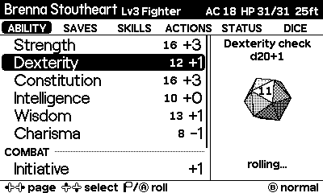

# Crit Crank


[](https://github.com/darthtrevino/crit-crank/actions/workflows/ci.yml)
[](https://darthtrevino.github.io/crit-crank/)

A D&D 5e character sheet for [Playdate](https://play.date). Pick an ability, save, skill, attack or spell, then **turn the crank to roll 3D dice**. It hits you with an air horn on a natural 20 and a sad trombone on a natural 1.

**[Try the browser demo →](https://darthtrevino.github.io/crit-crank/)**



## What's in here

| Path | What |
| --- | --- |
| [`charsheet/`](charsheet) | The Playdate game (Lua). Prebuilt heroes, 3D dice, dice pools, rests, resource tracking, and rule text on the pause screen. |
| [`charsync/`](charsync) | Rust CLI (macOS/Windows/Linux) that imports your D&D Beyond characters onto the device over USB. |
| [`site/`](site) | The GitHub Pages showcase, with an interactive in-browser demo. |
| [`AGENTS.md`](AGENTS.md), [`.github/skills/`](.github/skills) | Notes and skills for AI coding agents working in this repo. |

## Quick start

Requires the [Playdate SDK](https://play.date/dev/) (3.x), with `PLAYDATE_SDK_PATH` set or `~/.Playdate/config` present.

```sh
cd charsheet
make run          # build with pdc and open in the Simulator
```

To play on hardware, download `crit-crank.pdx.zip` from the [site](https://darthtrevino.github.io/crit-crank/) or a CI run, and sideload it at [play.date/account/sideload](https://play.date/account/sideload/).

To bring in a D&D Beyond character (it must be set to Public):

```sh
cd charsync
cargo run --release -- import https://www.dndbeyond.com/characters/<id>
```

See the [charsheet README](charsheet/README.md) for controls and rules, and the [charsync README](charsync/README.md) for everything it converts.

## Development

```sh
# Lua lint (luacheck on Lua 5.4)
charsheet/tools/lint.sh

# Game build
(cd charsheet && make build)

# charsync
(cd charsync && cargo fmt --check && cargo clippy --all-targets -- -D warnings && cargo test)

# Site preview
(cd site && python3 -m http.server)
```

CI runs all of these on every pull request and push to `main`. Pushes to `main` also rebuild the game and deploy the site to GitHub Pages.

## License

[MIT](LICENSE), except the bundled Playdate system fonts, which belong to Panic, Inc. (see [`charsheet/source/fonts`](charsheet/source/fonts)).

Not affiliated with Panic, Wizards of the Coast or D&D Beyond. Dungeons & Dragons is a trademark of Wizards of the Coast.
